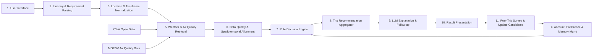

# Design

## Context

See [proposal.md](file:///d:/碩士/物聯網/1111_DIC/openspec/changes/personalized-weather-assistant/proposal.md) for motivation and capability boundaries. This design translates `DESIGN.md` into an implementable architecture while preserving all 11 system modules, 7 design principles, 6 conceptual data entities, and strict separation between deterministic rule evaluation and LLM natural-language processing. Concrete technology frameworks, API endpoints, numeric thresholds, and experimental results remain `TBD` until implementation and validation.

## Goals / Non-Goals

**Goals:**
- Preserve the 11-module architecture and 7-step end-to-end execution pipeline defined in `DESIGN.md` (§3, §4, §8).
- Enforce deterministic, versioned, reproducible environmental risk evaluation grounded in official CWA and MOENV data snapshots (`EnvironmentalSnapshot`, `SegmentDecision`).
- Enforce explicit quality-flag propagation (`missing`, `stale`, `spatially-coarse`, `unavailable`) and structured fallback when official data or LLM generation fails.
- Maintain strict separation between explicit `UserProfile` preferences, immutable decision snapshots, `FeedbackRecord`, and user-confirmed `PreferenceUpdateCandidate`.

**Non-Goals:**
- Re-predicting, interpolating, or altering official CWA/MOENV numerical weather or air quality values.
- Modeling inter-stop transit routing or mobility paths between user-defined stopover segments.
- Allowing LLMs to perform numeric threshold checks, change alert priorities, or hallucinate missing environmental observations.
- Committing to specific web frameworks, databases, LLM providers, or unverified numeric thresholds prior to the implementation stage (`TBD`).

## Architecture & Module Mapping (11 Modules)

| # | Module | Core Responsibility | Primary Input | Primary Output |
|---|---|---|---|---|
| 1 | User Interface | Create/edit itineraries and preferences; render 3-layer results | Location, time, activity, preferences | Trip request, UI views |
| 2 | Itinerary & Requirement Parsing | Parse form inputs or NL supplements; trigger confirmation on ambiguity | User input | Draft itinerary segments |
| 3 | Location & Timeframe Normalization | Validate Taiwan places; resolve coordinates, township, air quality area, time range | Draft segments | `ItinerarySegment` |
| 4 | Account, Preference & Memory Management | Manage versioned explicit preferences, trip history, feedback, pending updates | Account data, feedback | `UserProfile`, history |
| 5 | Weather & Air Quality Data Retrieval | Query official CWA and MOENV sources and retain source metadata | `ItinerarySegment` | Raw payloads + metadata |
| 6 | Data Quality & Spatiotemporal Alignment | Align time/space; check station distance, freshness, and missingness | Raw payloads, segment | `EnvironmentalSnapshot`, quality flags |
| 7 | Rule Decision Engine | Run versioned rules using snapshot, segment, quality flags, and profile | Snapshot, segment, `UserProfile` | `SegmentDecision` |
| 8 | Trip Recommendation Aggregator | Deduplicate cross-stop alerts, rank protection above comfort, keep stop evidence | `SegmentDecision[]` | `TripRecommendation` |
| 9 | LLM Explanation & Follow-up Handling | Verbalize `TripRecommendation` and answer "why?" from recorded evidence | Structured decisions | Grounded explanation text |
| 10 | Result Presentation | Display 3 layers: primary action, concise reasons, sources/timestamps/limits | `TripRecommendation` | User-facing output |
| 11 | Post-Trip Survey & Preference Update Candidates | Record perceived match & usefulness; propose pending preference candidates | Survey, history | `FeedbackRecord`, `PreferenceUpdateCandidate` |

## Conceptual Data Models

Field types, database engine, and retention durations are `TBD` (deferred to implementation):

- `UserProfile`: `userId`, `explicitPreferences` (`rainTolerance`, `sunProtectionPriority`, `airQualityAlertSensitivity`, `thermalPreference`), `confirmedPreferenceVersion`, `createdAt`, `updatedAt`
- `ItinerarySegment`: `segmentId`, `itineraryId`, `placeName`, `latitude`, `longitude`, `township`, `airQualityArea`, `startTime`, `endTime`, `activityType`, `outdoorExposureLevel`
- `EnvironmentalSnapshot`: `segmentId`, `sourceType`, `sourceName`, `spatialReference` (`township | station | air-quality-area`), `observedOrForecastTime`, `publishedAt`, `fetchedAt`, `weather` (`temperature`, `humidity`, `precipitationProbability`, `uvIndex`), `airQuality` (`aqi`, `majorPollutant`, `pollutantValues`), `qualityFlags` (`missing | stale | spatially-coarse | unavailable`)
- `SegmentDecision`: `segmentId`, `alerts` (`category`, `priority`, `recommendedAction`), `evidence` (`source fields`, `ruleId`, `profile factors`), `limitations`
- `FeedbackRecord`: `itineraryId`, `segmentId`, `submittedAt`, `perceivedWeatherMatch`, `perceivedAirQualityMatch`, `recommendationUsefulness`, `freeText`
- `PreferenceUpdateCandidate`: `preferenceKey`, `proposedValue`, `reason`, `evidenceSummary`, `status` (`pending-confirmation | accepted | rejected`)

## Decisions

1. **Hybrid Deterministic Rule Engine + Grounded LLM Split**
   - *Decision*: Keep all numeric threshold comparisons, health protection logic, and priority ordering inside a versioned deterministic rule engine (`Module 7`), restricting the LLM (`Modules 2, 9`) to structured NL parsing (with user confirmation) and evidence-bound explanation/follow-up.
   - *Rationale*: Direct LLM environmental reasoning risks numerical hallucination, inconsistent rule compliance, and lack of auditability. Deterministic `ruleId` outputs paired with `EnvironmentalSnapshot` and `confirmedPreferenceVersion` guarantee full reproducibility.
   - *Alternatives Considered*: End-to-end LLM autonomous decision-making (rejected due to non-reproducibility and safety risk); fixed rules + static templates only (retained as Baseline B; lacks natural-language clarification and explanation flexibility).

2. **Timeframe-Driven Air Quality Source Selection (Real-Time vs. `AQF_P_01` vs. Unavailable)**
   - *Decision*: Route ongoing/current segments to the nearest MOENV real-time monitoring station, next-day covered segments to MOENV `AQF_P_01` air-quality-area forecasts, and out-of-horizon segments to an explicit unavailable state while still producing CWA weather guidance.
   - *Rationale*: Prevents conflating real-time station measurements with future conditions or misrepresenting area-level daily forecasts as localized hourly readings.
   - *Alternatives Considered*: Extrapolating current AQI into multi-day forecasts (explicitly prohibited as out of scope).

3. **Explicit Quality-Flag Propagation & Partial Degradation**
   - *Decision*: Annotate snapshots with `missing`, `stale`, `spatially-coarse`, and `unavailable` flags and propagate them through `SegmentDecision.limitations` to `Module 10`.
   - *Rationale*: Preserves partial utility (e.g., providing rain/UV guidance when air quality forecast is unavailable) without fabricating unsupported risk assertions.

4. **Versioned Explicit Preferences & User-Confirmed Feedback Loop**
   - *Decision*: Separate `UserProfile`, `FeedbackRecord`, and `PreferenceUpdateCandidate`; require explicit user confirmation before bumping `confirmedPreferenceVersion`; disallow any preference or feedback from suppressing mandatory health alerts.
   - *Rationale*: Prevents silent profile drift and ensures subjective comfort tolerance never disables objective health safeguards.

5. **Three-Layer Presentation & Deterministic Fallback**
   - *Decision*: Present (1) primary actionable guidance, (2) concise causal reasons, and (3) official data sources, timestamps, and limitations. If LLM explanation fails fidelity verification, render the structured `SegmentDecision` and `TripRecommendation` directly.
   - *Rationale*: Balances actionability for commuters/travelers with full transparency and zero-hallucination safety.

## Risks / Trade-offs

- **[LLM Explanation Drift or Contradiction]** → Enforce post-generation verification against recorded numbers, alerts, valid periods, and limitations; fall back directly to structured `SegmentDecision` output on mismatch or timeout.
- **[Data Temporal/Spatial Mismatch Across CWA & MOENV]** → Retain separate `spatialReference`, `observedOrForecastTime`, and `publishedAt` metadata per source; surface station distance and `spatially-coarse` / `stale` flags explicitly instead of smoothing across sources.
- **[Cold-Start & Preference Misalignment]** → Rely on explicit initial `UserProfile` settings and conservative official defaults; accumulate `FeedbackRecord` evidence into `PreferenceUpdateCandidate` only with user confirmation.
- **[Unresolved Thresholds & Stack Decisions]** → Keep concrete thresholds and infrastructure choices tracked explicitly as Open Questions (`TBD`) rather than hardcoding unverified values.

## Open Questions (Deferred to Implementation Phase — `TBD`)

Per `DESIGN.md` §12, the following technical decisions are intentionally deferred (`TBD`):
1. **Application Stack & Hosting (`TBD`)**: Frontend framework, backend service runtime, database engine, and deployment platform.
2. **Official API Integration Details (`TBD`)**: Specific CWA and MOENV endpoint URLs, API key management, rate limits/polling intervals, and retry/backoff policies.
3. **Geospatial & Station Matching (`TBD`)**: Taiwan place-name geocoding/resolution mechanism, station nearest-distance formula, and maximum acceptable spatial radius before flagging `spatially-coarse`.
4. **Freshness & Degradation Thresholds (`TBD`)**: Per-source staleness thresholds (`stale`) and exact partial-degradation rules.
5. **Domain Rule Numeric Thresholds (`TBD`)**: Concrete numeric cutoffs for precipitation, UVI, pollutant-specific air quality, and thermal comfort mapped to official CWA/MOENV/WHO/health guidelines, plus rule versioning workflow.
6. **Authentication & Data Retention (`TBD`)**: User authentication mechanism, data retention periods, and full personal data governance policy.
7. **LLM Provider & Verification Pipeline (`TBD`)**: Model/provider selection, prompt templates, request timeouts, and automated fidelity-checking implementation.
